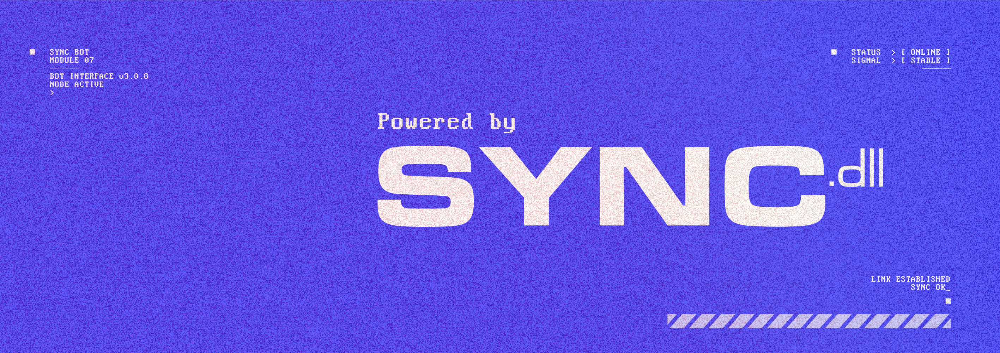

# DJ Peligro

DJ Peligro is a Discord music bot that plays audio
from YouTube links in voice channels.

It provides interactive playback controls, manual
song queues, and automatic music recommendations.

Powered by **SYNC.dll**.

   
  <b>USE OURS OR RUN YOURS</b>

## Features

- YouTube audio playback in Discord voice channels.
- Manual song queue management.
- Automatic music recommendations.
- Play, pause, next, previous, and stop controls.
- Intro and loading audio cues.
- Playback source fallback for compatible videos.
- Automatic session cleanup.

## Commands

### `play <YouTube URL>`

Requests a song from a YouTube link.

The user must be connected to a voice channel.
If music is already playing, the request is queued.

## Requirements

- Node.js 22 and npm
- Python 3 with virtual environment support
- yt-dlp
- FFmpeg
- Deno
- A Discord application and bot token
- The original audio assets for full functionality

## Discord permissions

The bot requires:

- View Channels
- Send Messages
- Embed Links
- Connect
- Speak

Manage Messages is needed to delete user command
messages during session cleanup.

The privileged Message Content Intent must be
enabled in the Discord Developer Portal.

Installation scope:

- `bot`

## Installation

Clone the repository:

    git clone https://github.com/Syncdll/discord-bot-dj-peligro.git DJ-Peligro
    cd DJ-Peligro

Install the Node.js dependencies:

    npm ci

Create an isolated Python environment:

    python3 -m venv .venv-radio

Install the radio dependencies:

    .venv-radio/bin/python -m pip install -r requirements-radio.txt

Do not upgrade shared system dependencies.

### Environment configuration

Create the environment file:

    cp .env.example .env
    chmod 600 .env

Configure the Discord bot token using TOKEN.

Set the executable paths for:

- YTDLP_PATH
- FFMPEG_PATH
- YTMUSIC_PYTHON_PATH
- DENO_PATH

Use absolute paths for reliable service execution.

Never commit .env or share authentication tokens.

### Running the bot

For manual execution:

    node index.js

Do not start a second instance while the production
service is running with the same Discord token.

For systemd deployment and disaster recovery,
see RESTORE.md.

## Runtime data

DJ Peligro maintains playback queues and active
session information in memory.

The bot does not use a dedicated database for
storing user profiles or playback history.

Operational logs may contain playback commands,
YouTube URLs, song titles, and technical errors.

Logs are retained according to the configuration
of the hosting system.

See PRIVACY.md for additional information.

## Project structure

    DJ-Peligro/
    ├── assets/
    │   ├── avatar.jpg
    │   └── banner.jpg
    ├── audio/
    │   ├── Intro.wav
    │   └── loading.wav
    ├── deploy/
    │   └── dj-peligro.service.example
    ├── .env.example
    ├── .gitignore
    ├── index.js
    ├── ytmusic_radio.py
    ├── package.json
    ├── package-lock.json
    ├── requirements-radio.txt
    ├── README.md
    ├── RESTORE.md
    ├── PLAYBACK_ARCHITECTURE.md
    ├── PRIVACY.md
    ├── TERMS.md
    ├── THIRD_PARTY_NOTICES.md
    └── LICENSE

## Privacy

See [PRIVACY.md](PRIVACY.md).

## Terms

See [TERMS.md](TERMS.md).

## License

See [LICENSE](LICENSE).

Third-party media assets are documented in [THIRD_PARTY_NOTICES.md](THIRD_PARTY_NOTICES.md).

For disaster recovery instructions, see [RESTORE.md](RESTORE.md).
